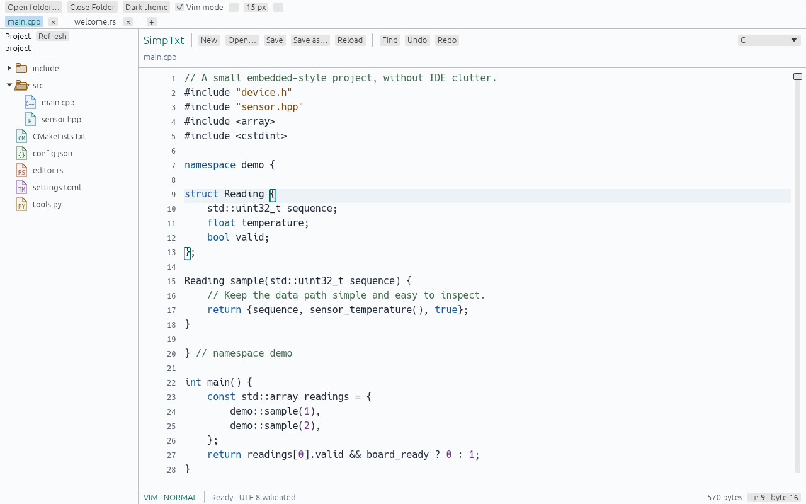

# SimpTxt

A minimalist desktop text editor focused on opening files quickly, editing safely, and highlighting source code without IDE clutter.

**Status: early implementation, not a production-ready release.** Windows, macOS, and Linux are the targets. Responsive editing of single files up to 1 GB is a requirement being validated, not a universal performance guarantee. Keep backups when evaluating the app.

### Dark


### Light



*Actual SimpTxt application rendered headlessly using its shared editor UI and egui/wgpu renderer, opening [`examples/welcome.rs`](examples/welcome.rs). This is not a mockup. Offscreen rendering does not validate native window integration or OS input methods.*

## Focus

- Independent file tabs with open, edit, Save / Save As, undo / redo, and literal find / replace.
- A lazy, read-only project-folder sidebar. No project-wide scan or indexing.
- Optional Vim-style editing, editor text zoom, and dark/light themes.
- Bounded, syntax-aware matching-pair highlighting for `()`, `[]`, and `{}`.
- Source highlighting for Rust, C/C++, and JSON; other files remain plain text.
- A small interface with no AI, embedded terminal, plugin marketplace, or project indexing.
- Immediate bounded preview, followed by background UTF-8 validation and indexing. The preview is read-only until editing is ready.
- A chunked text core, bounded viewport rendering, and background search/highlighting/save work.

See [REQUIREMENTS.md](REQUIREMENTS.md) for the agreed scope, provisional performance targets, assumptions, and acceptance plan. See [workspace validation](docs/workspace-validation.md) for this branch and [baseline large-file results](docs/validation.md) for earlier measurements and remaining gaps.

Three real 1 GB fixture families (source, logs, and a giant single line) passed the local core open/edit/undo/save/reopen pipeline. These were single uncontrolled-cache trials, not GUI latency or cross-platform acceptance results.

## Build and run

Install Rust **1.95.0 or newer**, with the platform's normal Rust linker/build tools. The desktop renderer also needs a working Vulkan, Metal, or Direct3D 12 adapter; a suitable software adapter may be used in headless environments.

For an existing clone, update the original feature branch before building:

```sh
git fetch origin
git switch feature/minimal-editor
git pull --ff-only
cargo run --locked --release -- path/to/file.rs
```

Omit the file argument to start with a new document. Linux also requires the native windowing libraries listed in [the CI workflow](.github/workflows/ci.yml).

Common shortcuts use Ctrl on Windows/Linux and Command on macOS:

- N: new file; O: open; S: save; Shift+S: save as.
- F: find/replace; G: go to line.
- Z: undo; Shift+Z: redo; A: select all.
- W: close the current tab; Tab / Shift+Tab: next / previous tab.
- `+` (or `=`), `−`, and mouse wheel: editor text zoom while Ctrl is held; Ctrl 0 resets. Command shortcuts are also accepted on macOS.
- Standard copy, cut, paste, arrow, Home/End, and Page Up/Down controls.

Use **Light theme** / **Dark theme** in the top toolbar to switch the entire interface without changing the documents. Text zoom is shared across tabs and bounded to 9–36 px.

Use **Open folder…** for the sidebar. Reopening a file focuses its existing tab, preserving unsaved edits; Save As refuses a destination already owned by another tab. Closing the window walks all unsaved tabs. Cancelling quit retains every tab, including tabs whose discard decision had already been made for that quit attempt.

### Optional Vim-style mode

Enable **Vim mode** in the toolbar. It starts in Normal mode; the footer shows Normal, Insert or Visual and any `:` command. Mode/pending commands reset when switching tabs or leaving editor focus. Preferences are session-local, with dark theme and ordinary editing as startup defaults.

Implemented subset:

- Motions: `h j k l`, arrow keys, `0 ^ $`, `w b e`, `gg`, `G`, with bounded numeric counts.
- Insert: `i I a A o O`, then Escape to Normal. Ordinary text/IME input is used in Insert mode.
- Characterwise Visual: `v`, motions, then `d`, `c`, `y` or `x`; Escape cancels.
- Operators: `d`, `c`, `y` with supported motions, including `dd`, `cc`, `yy`; `x` deletes characters without crossing the line ending.
- `p` / `P` use the tab-local unnamed register, `u` undoes, Ctrl+R redoes.
- `:w`, `:q`, `:wq`, `:q!`. Quit commands close the current tab. `:q` prompts for unsaved edits; `:wq` closes only after a successful current-revision save; explicit `:q!` discards that tab's unsaved edits, but refuses during an active file operation.

This is **not full Vim compatibility**. There are no mappings, macros, marks, text objects, named registers, dot-repeat, Vim search, visual-line/block mode, counted insert commands, or Visual replacement paste. Word motions use Unicode alphanumeric/underscore versus punctuation classes, not configurable Vim options. Motion scans are bounded to 64 KiB, counts to 1,000, and edit/register operations to 16 MiB; exceeding a safety limit reports an error without a partial operation. Standard clipboard paste is available in Insert mode; Normal-mode `p` is not the system clipboard. Undo uses the editor's existing edit transactions, not whole Vim Insert-session grouping. Vertical movement uses Unicode scalar columns rather than grapheme/display columns and does not retain a preferred column across short lines.

## Test

```sh
cargo fmt --all -- --check
cargo clippy --locked --all-targets -- -D warnings
cargo test --locked --all-targets
cargo test --locked --no-default-features --all-targets
cargo test --locked --doc
```

The suite covers the document core, randomized edits and undo/redo, UTF-8 boundaries, line endings, file I/O, failure-safe saves, search/highlighting, and in-process editor interactions.

A native-window startup smoke test opens the real event loop, exercises basic editing/undo/redo across rendered frames, and exits:

```sh
cargo run --locked -- --smoke-test
```

The [GitHub Actions workflow](.github/workflows/ci.yml) builds and tests on Linux, Windows, and macOS, including native-window smoke checks. Workflow configuration is not evidence of a passing run; consult the repository's [Actions results](https://github.com/Linn39403/SimpTxt/actions).

### Real 1 GB regression

Run fixture families separately to bound disk use. Each needs roughly twice the fixture size in free temporary storage during saving, plus build storage and sufficient RAM.

```sh
cargo test --locked --release --no-default-features --test large_file \
  one_gigabyte_open_edit_save -- --ignored --exact --nocapture
```

The default family is `source`. Set `SIMPTXT_FIXTURE_FAMILY=logs` or `SIMPTXT_FIXTURE_FAMILY=long` to exercise dense logs or an extremely long line. These are core file-operation tests, not end-to-end GUI latency or cold-cache p95 benchmarks. A manual CI input also enables the heavier file regressions when workflow dispatch is available.

### Reproduce the screenshot

```sh
cargo run --locked -- --headless-screenshot docs/images/simptxt.png examples/welcome.rs \
  --vim --folder src --tab Cargo.toml --cursor-byte 204
cargo run --locked -- --headless-screenshot docs/images/simptxt-light.png examples/welcome.rs \
  --light --vim --folder src --tab Cargo.toml --cursor-byte 204
```

This runs the actual editor, waits for the sample's loading/highlighting, and captures its GPU-rendered output without an OS window. It still requires a suitable graphics driver. `WGPU_BACKEND` can select `vulkan`, `metal`, or `dx12` where supported.

## Current boundaries

- UTF-8 is the editable encoding. Invalid UTF-8 or NUL-containing input is not silently converted into editable text. Named symbolic links are rejected rather than followed unexpectedly.
- No soft wrapping. Very long lines are displayed in bounded horizontal regions.
- At most 128 tabs are open at once. New file opens reserve against a combined 2 GiB open-document/load budget, with at most two active file operations. This is not a total memory guarantee: undo snapshots, later edits, graphics and indexes consume additional memory.
- Folder listing is lazy and bounded: 256-entry increments, at most 2,048 entries per directory, 8,192 cached entries and 128 expanded directories. Partial listings are visibly labeled; there is no promise of unlimited project browsing.
- Matching-pair searches examine at most 24 KiB in one direction, with total lexical replay/scan under 64 KiB. Missing lexical state or a distant match yields no guessed highlight; a status message distinguishes an unknown result.
- Clipboard/individual insertion size is limited to 16 MiB; undo history is limited to 1,000 actions. Large-file support does not mean unlimited clipboard or undo memory.
- This prototype has a 2 GiB document/output safety ceiling; replace-all expansion is checked before allocation. This is a safety limit, not a claim that 2 GiB has been performance-qualified.
- Literal search only, with a 1 MiB search-pattern limit and a 1,000,000-match replace-all limit. Operations exceeding safety limits report an error instead of silently truncating content.
- Highlighting may temporarily fall back to plain text while lexical state is prepared. C/C++ backslash-newline/trigraph cases conservatively use plain text instead of claiming complete language support.
- Bundled font coverage is limited; some CJK, emoji, and other scripts may display missing-glyph boxes even when the underlying UTF-8 bytes are preserved.
- Unicode codepoint editing is implemented; full grapheme-cluster, bidirectional-text, IME, and accessibility behavior still needs broader qualification.
- Saving writes a separate temporary file and checks for external changes before replacement. Unix mode bits are preserved; Windows ACLs, alternate streams, all filesystem metadata, and race-free external-change detection are not guaranteed. Filesystem durability varies; retain backups.
- The project is not yet signed, notarized, or packaged as an installer. Cross-platform CI and local headless checks do not replace hands-on testing on each desktop OS.

## License

A project license has not been selected or added yet. Public visibility alone does not grant a general reuse license. Dependency licenses remain their respective authors' licenses.
