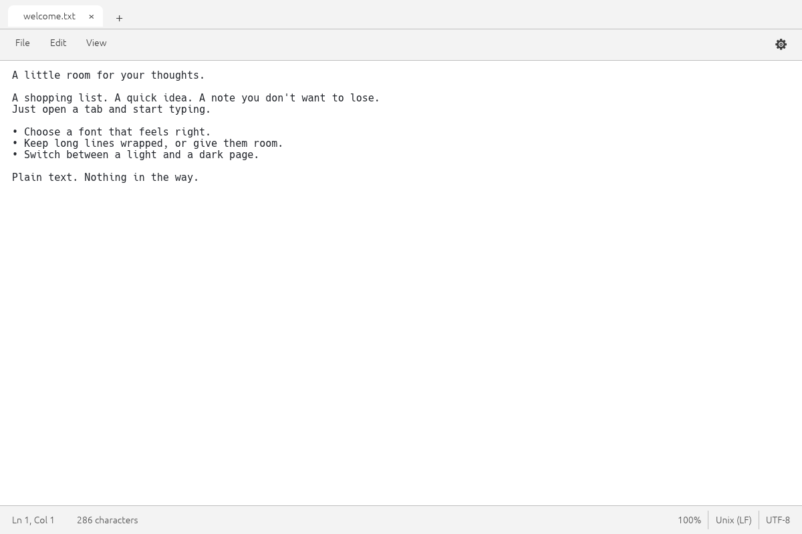
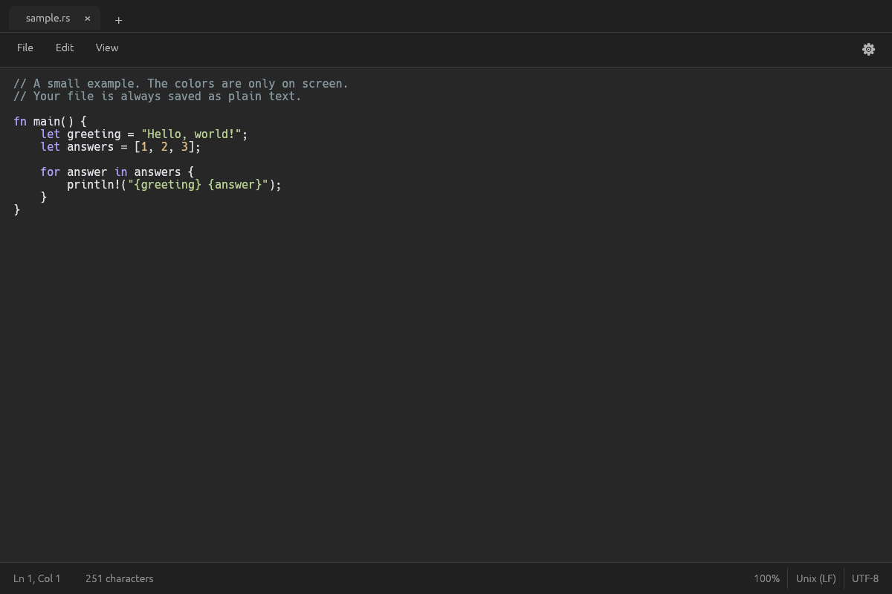
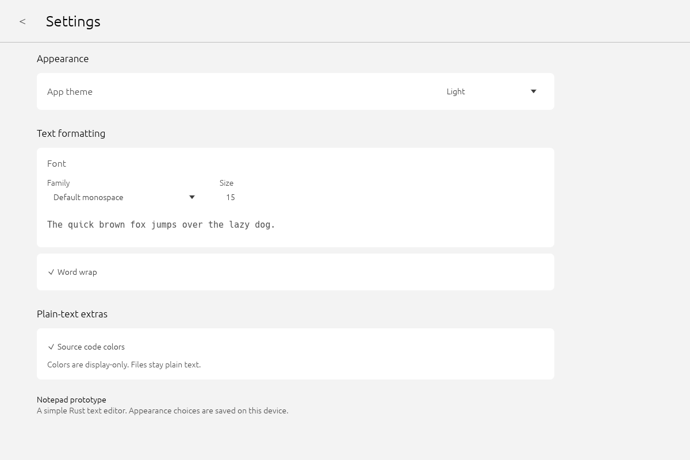

# Notepad prototype (working title)

A separate Rust plain-text editor prototype, inspired by the compact Windows 11 Notepad layout. It is a separate application, developed on the `feature/notepad-lite` branch of the SimpTxt repository rather than as a change to the existing SimpTxt application. “Notepad prototype” is a working title, not a finalized product name. See [requirements](REQUIREMENTS.md) and [provenance](docs/PROVENANCE.md).

## Run

With Rust 1.95 or later and the platform's graphics/native-dialog dependencies:

    cargo run --release -- [optional-file.txt]

Linux needs X11/Wayland, a working graphics driver and a desktop file-dialog portal. The CI workflow targets Linux, Windows and macOS; local evidence currently covers Linux only. Hosted CI results and native platform validation must be checked separately. Native window decorations remain platform-specific; this is not a pixel-exact recreation of Microsoft Notepad.

## Implemented vertical slice

- Tabs, compact File / Edit / View menus, settings gear, plain editor and status bar.
- UTF-8 open, save and save-as through native dialogs; byte-preserving UTF-8 BOM and newline handling.
- Dirty indicators and Save / Don't save / Cancel before closing a changed tab or exiting.
- Undo / redo, clipboard keyboard shortcuts and menu commands, select all, find / replace and replace all.
- Persistent font selection from discovered system TTF/OTF font files, font size, word wrap, zoom and light/dark themes.
- Basic display-only colors for known source extensions. No rich text, Markdown toolbar, project tree, terminal or AI features.
- Atomic same-directory saves, external-change conflict detection and bounded undo history.

## Rendering and saved preferences

The normal application uses eframe’s OpenGL/glow renderer. The wgpu renderer and application screenshot code are compiled only with the optional headless-capture feature; platform clipboard dependencies may still include image support. This reduces the native dependency graph; actual memory depends on the OS graphics driver, and no lightweight performance promise is made. Headless captures still use wgpu and are not a native OpenGL runtime benchmark.

Font, size, theme, wrap, zoom and source-color choices are saved atomically in the standard per-user configuration directory. The settings page includes a Back button and never stores document contents. Tests and headless captures use isolated defaults and never load or overwrite user preferences.

## Prototype boundaries

This initial implementation uses a whole-file UTF-8 string. File loading and saving are capped at 16 MiB. It is not a large-file editor, and no 1 GB capability is promised. Full-file layout and history copies mean even files below the cap may be slower than desired. UTF-16/legacy encodings, printing, autosave/session recovery, accessibility validation are not implemented. Fonts use file-stem labels rather than canonical family metadata, and TTC font collections are not supported. Source coloring is a small generic lexer rather than a complete language parser. Close protection is not crash recovery. OS-specific packaging, release-size/RAM budgets and Windows/macOS testing remain future work.

## Verification

    cargo test
    cargo clippy --all-targets -- -D warnings
    cargo run --features headless-capture -- --screenshot artifacts/light.png examples/welcome.txt
    cargo run --features headless-capture -- --screenshot artifacts/dark.png examples/sample.rs --dark

The screenshot path runs the production egui UI through an offscreen GPU renderer; it is not an HTML/mockup rendering. See docs/TEST_REPORT.md for actual test outcomes and limits. Screenshots omit OS window decorations.

## Prototype screenshots

These selected Linux offscreen captures show production UI widgets, not native OS window decorations. They do not establish Windows or macOS runtime behavior.

