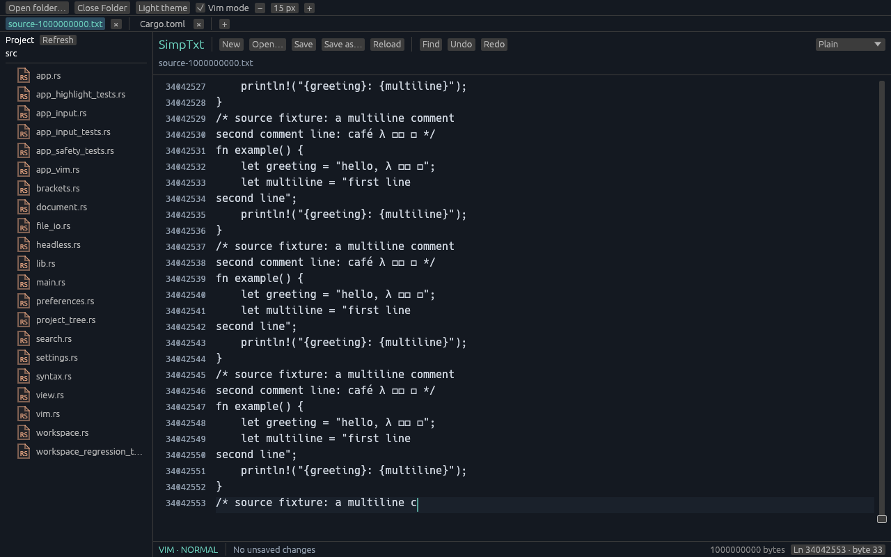

# Editing, memory and responsiveness follow-up

This follow-up stays on `feature/minimal-editor`. It fixes the review's reproduced input bugs and measured hot paths, and adds the explicitly requested small editing conveniences. It is not a production-readiness or full desktop-IME qualification claim.

## Changes and regression coverage

- Selected-line Tab / Shift-Tab edits every touched line in one transaction, preserves selection direction, and excludes an untouched last line. BOM, UTF-8 and CRLF cases are covered.
- IME surrounding deletion counts exactly the requested Unicode scalars. A CRLF is two scalars for this protocol, while ordinary keyboard deletion still treats its line ending atomically. Requests exceeding the documented bound are rejected without partial edits.
- Vertical navigation retains a preferred Unicode scalar column across short lines. Sparse scalar indexes avoid walking a giant line byte by byte for each movement. This is not grapheme/display-column navigation.
- Undo/redo restores caret and selection. Adjacent ordinary typing groups within a one-second pause; navigation, selection, paste, IME, save and other editing actions break the group. Whole Vim Insert-session grouping is not implemented.
- Enter copies bounded leading indentation; Ctrl/Option word navigation and deletion use bounded Unicode word-class scans.
- F3 / Shift+F3 and Find Enter / Shift+Enter search forward/backward with a single wrap. Escape returns focus to the editor. Reverse search starts near the caret rather than rescanning from byte zero.
- Native theme, zoom and Vim preferences persist through a bounded, atomic, user-local file. Invalid, oversized, linked or unknown-version settings are not silently overwritten. Headless/smoke modes do not access ambient preferences.
- File drops use the same tab identity, load admission and dirty-buffer rules as Open.
- External metadata checks run off-thread. Notices never reload a buffer automatically. Explicit Reload requires dirty-buffer confirmation and stages the new file: failure or cancellation preserves the previous document, history, cursor and path. Successful validation is the publication boundary.

## Memory boundaries

A process-wide tracked-document counter deduplicates shared immutable backing and index allocations. It includes retained undo and snapshots held by workers, even after a tab closes. Loads reserve before reading and carry that reservation through indexing; edits reserve before preparing output. Admission uses a **2 GiB tracked-document budget**, not a total process-memory promise. GUI, search/syntax working buffers, allocator behavior and OS overhead remain outside this accounting.

Each document's history is bounded by **128 MiB of unique history-only storage and 1,000 actions**. Live backing shared by history is not charged twice. Old history is evicted first. An edit whose own undo record exceeds the budget is rejected before publication with a clear limit message, including Replace All. The original document, selection and history remain unchanged. The live document is never truncated to satisfy a history limit.

## Reproducible measurements

The maintained core-only probe emits JSON and makes no machine-specific latency assertion:

```sh
cargo run --locked --release --no-default-features --example performance_probe -- 100000000
cargo run --locked --release --no-default-features --example performance_probe -- 1000000000
cargo run --locked --release --no-default-features --example performance_probe -- --history
```

Run the history workload in a **fresh process**, not after a large-file test: a reused allocator arena can mask resident-memory growth. It performs 40 genuinely alternating 8 MiB replacements and reports retained history, available undo actions, tracked storage and Linux RSS where available.

The baseline observation is retained in [before JSON](validation/review-performance-before.json). It records the original source hashes and measurement method. Final after measurements and test totals are below. Do not interpret these microbenchmark timings as a warm/cold desktop p95 guarantee.

Incremental highlighting requires exact lexer-state convergence and proof that the reused suffix is unchanged. Randomized equivalence tests compare refreshed indexes with fresh full builds across edits, skipped revisions, undo/redo and snapshot branches. A real lexical-state change, expired change history or initial load may still scan a suffix or whole file in a cancellable worker. Viewport tokens are prepared as one bounded batch and cached by document/index/ranges; stale results are not rendered.

## Remaining qualification

The tests exercise in-process egui events and real file operations. Native input methods, accessibility, grapheme/bidirectional rendering, sustained interactive latency and filesystem behavior still need hands-on testing on each supported desktop OS. Three-platform native-window smoke is separate evidence from local offscreen screenshots and core benchmarks.

## Final local checks

The final source passed formatting, strict Clippy (`-D warnings`), desktop build, **291 tests** (115 core, 171 desktop/UI, one randomized and four real-file integrations), and **120 no-desktop tests**. The three heavier opt-in tests remained ignored in these routine commands. Documentation tests completed with none present. The separate stress run passed **25,000 arbitrary byte/chunk cases and 125,000 randomized edit operations**, including bulk changes and undo/redo.

An independent reviewer authored 31 additional regression tests and checked the implementations separately. Review caught the failed-reload staging issue and two forms of misleading undo behavior before publication. The final rendered-frame Vim test proves that an edit refusal retains Visual selection/mode through the next frame, rather than merely passing an immediate event assertion.

[Final command log](validation/review-final-checks.log), [stress log](validation/review-final-prechecks.log), and [exact source/capture hashes](validation/review-final-provenance.json) record the checked tree. Hosted three-OS CI and its native-window smoke result are separate from these Linux local checks.

## Final performance observations

See [full methodology and before/after results](validation/review-performance.md), [100 MB JSON](validation/review-performance-100mb.json), [1 GB JSON](validation/review-performance-1gb.json), and [memory JSON](validation/review-memory-after.json).

In the controlled **favorable local-edit workload**, reverse Find at 100 MB inspected 7 bytes instead of 100,000,000, and incremental 1 GB syntax refresh averaged 2.128 ms versus a 21.061-second full index. This is not an every-edit guarantee: lexical-state changes and expired 64-transition proof can still require a larger cancellable scan. Initial progress is retained in a single replaceable slot, not an unbounded queue. Full lexing itself was not accelerated.

In a fresh process, 40 alternating 8 MiB replacements reduced final observed RSS from 353,816 KiB to 157,452 KiB while retaining 15 undo steps instead of all 40. This deliberately trades old history for a memory bound. Two-direction undo admission adds work: 100 MB insert+undo rose from 0.030 ms to 0.240 ms in this microbenchmark; the final 1 GB mean was 2.719 ms.

### Real 1 GB file pipelines

All three exact 1,000,000,000-byte fixture families passed fresh release-profile open/edit/undo/redo/save/cancel/reopen checks. Save output was compared byte-for-byte with an independent streaming oracle, including BOM, mixed line endings and multibyte text.

| Family | Editable load | Small edits | Edited save | Peak process RSS |
|---|---:|---:|---:|---:|
| Source | 5.745 s | 2.302–3.535 ms | 0.250 s | 1,013,520 KiB |
| Logs | 1.841 s | 2.084–3.004 ms | 0.236 s | 1,013,024 KiB |
| Single line | 1.929 s | 2.076–3.940 ms | 0.231 s | 1,008,824 KiB |

These are single, serial, uncontrolled-cache trials. Generated files and repeated reads warm caches; save throughput is not physical-disk throughput. The source process summary includes a short Cargo compilation, but operation timings do not. Raw [source](validation/review-1gb-source.log), [logs](validation/review-1gb-logs.log), [single-line](validation/review-1gb-long.log), and [machine-readable results](validation/review-1gb-core-results.json) are retained.

### Actual 1 GB workspace rendering

The real shared workspace opened the source fixture as plain text with a second tab and sidebar, then inserted and undid text at the beginning, middle and end. Each undo restored the saved revision. The run completed with:

- First completed preview frame: **177.567 ms**.
- Fully editable: **19.773 s**.
- Six edit/undo frames through GPU completion: **16.130–40.346 ms**, mean **26.980 ms**.
- Peak child RSS: **1,109,048 KiB**.



This was one development-profile run with package opt-level 1, unoptimized dependencies and software Vulkan at 1280×800, after graphics initialization. It is not native keyboard automation, process-startup timing, release-GUI performance or a p95 result. Compared with the earlier workspace observation (15.612-second readiness and 17.081 ms mean frame time), this run was slower; host/cache effects and the added index/safety bookkeeping were not isolated. The quick read-only preview must not be described as instantly editable. Source highlighting readiness is measured separately above.

[UI raw log](validation/review-1gb-ui.log) and [process measurements](validation/review-1gb-ui-resources.json) retain the exact observations. Dark/light and clean-start screenshots in the README were refreshed from the same built application and visually inspected. No screenshot is a mockup or an edited rendering.
