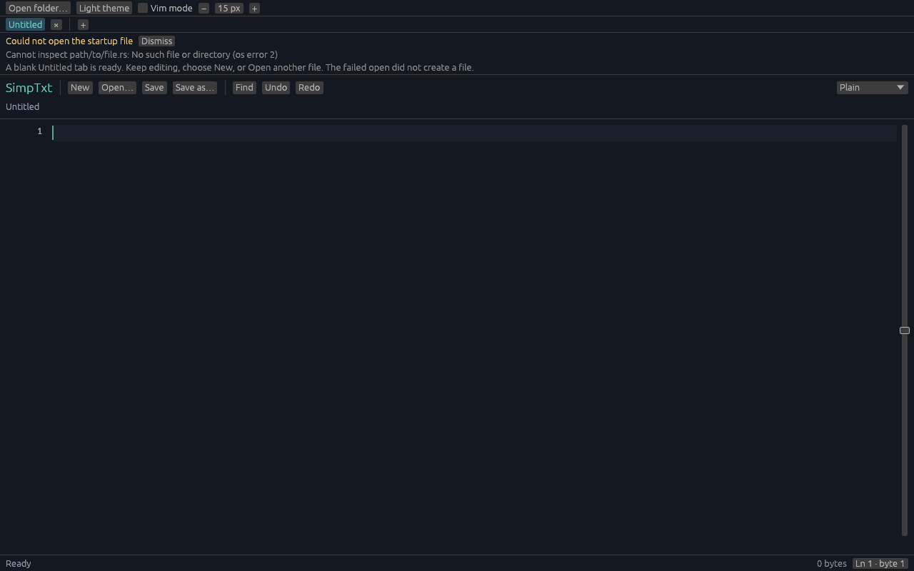
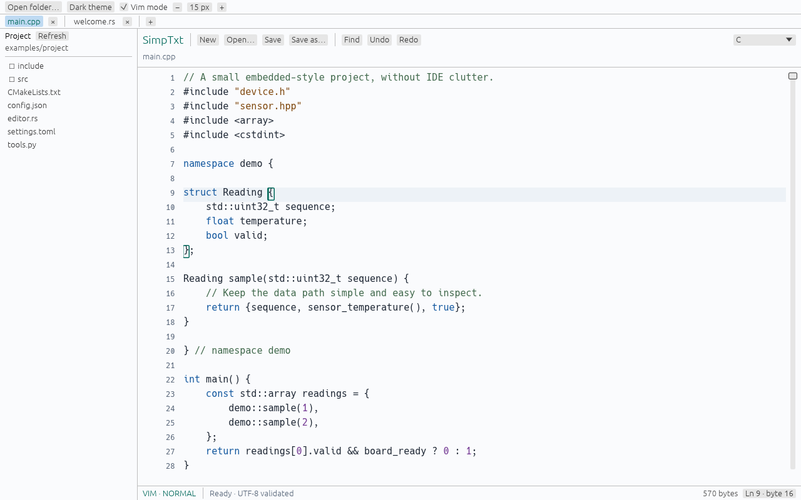

# Startup and sidebar feedback — 2026-10-20

These changes follow the workspace implementation merged in [PR #1](https://github.com/Linn39403/SimpTxt/pull/1), at `40cfa7d0334e0fbb332e76b63c4d6652af8bfda8`. They are a separate follow-up, not part of that initial PR.

## Startup recovery

The copy/paste build command now starts an untitled editor instead of passing a placeholder filename. If an explicit startup path cannot be opened, the shared native startup constructor leaves an editable Untitled tab and shows a dismissible nonmodal warning. The attempted path is retained in the message; long details truncate with a full tooltip. No missing file is created, and a failed path is not treated as successfully loaded.

Seven independent regressions exercise missing and valid startup paths, actual paint output and New-button interaction, immediate typing, subsequent valid Open, preserved dirty buffers/undo/cursor/path, inactive asynchronous failure, stale generations, and separation from ordinary Open errors. Ordinary Open/Reload safety behavior remains unchanged.

**Deliberately simulated error, not normal startup:** the screenshot below supplies the nonexistent `path/to/file.rs` to test recovery. Launching SimpTxt normally without a file argument opens a clean Untitled editor with no warning.



This is the real application rendered at 1280×800, not a mockup. Reproduce this diagnostic screenshot with:

```sh
cargo run --locked -- --headless-screenshot startup-warning.png path/to/file.rs --startup-warning
```

The explicit diagnostic flag permits a startup-error screenshot; ordinary captures still reject a missing fixture. It is rejected for `--headless-benchmark`, so an error screen cannot count as a successful file benchmark. Both guard cases have tests. The screenshot run also checked that `path/to/file.rs` did not exist before or afterward.

## Sidebar rendering

Disclosure triangles, closed/open folder silhouettes and document outlines now use egui vector painting. File badges use supported ASCII text, with C, C++, header, Rust, Python, JSON, TOML and CMake classifications plus a generic fallback. No external icon font, downloaded icon asset or new dependency was added.

Rows retain bounded rendering, aligned indentation, whole-row click targets, accessible labels and full-path tooltips. The root label is a one-line basename instead of a wrapping full path. Classifier, bounds, label, dark/light vector-rendering and capture-readiness tests cover the changes. Existing lazy listing, cancellation, symlink and raw-path safety tests remain intact.

### Before



This baseline image was rendered from the committed PR #1 source, with the same new sample project. Its folders remain collapsed because the old capture path did not reveal the open file.

### After: light


### After: dark


The new captures show an expanded `src` folder, collapsed `include`, a C++ source file, a header, and the root type badges. Capture-only file reveal follows bounded parent paths inside the selected root, leaving sibling folders collapsed; it does not recursively scan the project. The tiny [sample project](../examples/project/src/main.cpp) also compiled with C++17 and strict compiler warnings, then exited successfully.

## Checks and limits

Final local checks passed: formatting, strict Clippy, build, **188 tests** (83 core, 100 desktop/UI, one randomized and four real-file integrations), and **88 no-desktop tests**. Three expensive file fixtures remain opt-in; documentation tests ran successfully with none present. [Command log](validation/ui-feedback-checks.log) and [source/capture hashes](validation/ui-feedback-provenance.json) record this snapshot.

The captures use the actual shared workspace and egui/wgpu renderer with software Vulkan. They establish visual rendering, not native OS input, file-picker automation or accessibility acceptance. Native-window smoke and the complete suite remain in all-three-OS CI; consult the follow-up PR and [Actions](https://github.com/Linn39403/SimpTxt/actions) for the published revision's hosted result. No new 1 GB performance claim is made for these UI-only changes; earlier measurements retain their original source scope.
