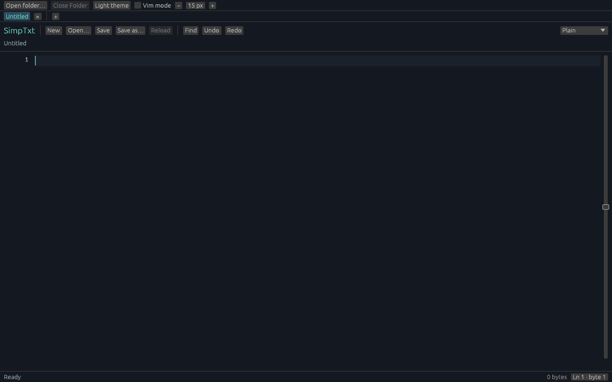

# Startup and sidebar feedback — 2026-10-20

These changes follow the workspace implementation merged in [PR #1](https://github.com/Linn39403/SimpTxt/pull/1), at `40cfa7d0334e0fbb332e76b63c4d6652af8bfda8`. They are a separate follow-up, not part of that initial PR. Test totals and provenance below are historical. Shared screenshot assets are refreshed for the latest UI; see [current editing/performance validation](review-fixes-validation.md) for the latest source and captures.

## Startup recovery

The copy/paste build command starts an untitled editor instead of passing a placeholder filename. A missing command-line startup path now opens a clean, editable Untitled tab with no warning banner or dialog. No missing file is created, and the failed path is not assigned as a loaded file or save destination. Permission, unsupported-format and other genuine opening errors remain visible, as do interactive Open errors and all save failures.

Regression tests exercise missing and valid startup paths, actual paint output and New-button interaction, immediate typing, subsequent valid Open, preserved dirty buffers/undo/cursor/path, inactive asynchronous failures, stale generations, and separation from ordinary Open/save errors. Error classification comes from the failing I/O operation, not error-message matching or a later filesystem check.



This is the real application rendered at 1280×800 with an intentionally nonexistent startup path. It has the same clean Untitled appearance as launching without a file argument, not a mockup. Reproduce it with:

```sh
cargo run --locked -- --headless-screenshot startup-clean.png path/to/file.rs --startup
```

The explicit `--startup` capture flag exercises native startup recovery; ordinary file captures still reject a missing fixture. It is rejected for `--headless-benchmark`, so a blank document cannot count as a successful file benchmark. Both guard cases have tests. The screenshot run also checks that `path/to/file.rs` does not exist before or afterward.

## Sidebar rendering

Disclosure triangles, closed/open folder silhouettes and document outlines now use egui vector painting. File badges use supported ASCII text, with C, C++, header, Rust, Python, JSON, TOML and CMake classifications plus a generic fallback. No external icon font, downloaded icon asset or new dependency was added.

Rows retain bounded rendering, aligned indentation, whole-row click targets, accessible labels and full-path tooltips. The root label is a one-line basename instead of a wrapping full path. Classifier, bounds, label, dark/light vector-rendering and capture-readiness tests cover the changes. Existing lazy listing, cancellation, symlink and raw-path safety tests remain intact.

### Before


This baseline image was rendered from the committed PR #1 source, with the same new sample project. Its folders remain collapsed because the old capture path did not reveal the open file.

### After: light


### After: dark


The new captures show an expanded `src` folder, collapsed `include`, a C++ source file, a header, and the root type badges. Capture-only file reveal follows bounded parent paths inside the selected root, leaving sibling folders collapsed; it does not recursively scan the project. The tiny [sample project](../examples/project/src/main.cpp) also compiled with C++17 and strict compiler warnings, then exited successfully.

## Checks and limits

The previous startup/sidebar snapshot (`a903c0934f12a21762df0177eeeba4c45e7460f5`) passed: formatting, strict Clippy, build, **188 tests** (83 core, 100 desktop/UI, one randomized and four real-file integrations), and **88 no-desktop tests**. Three expensive file fixtures remain opt-in; documentation tests ran successfully with none present. [Command log](validation/ui-feedback-checks.log) and [source/capture hashes](validation/ui-feedback-provenance.json) record that earlier snapshot. The clean-startup follow-up is recorded separately below.

The captures use the actual shared workspace and egui/wgpu renderer with software Vulkan. They establish visual rendering, not native OS input, file-picker automation or accessibility acceptance. Native-window smoke and the complete suite remain in all-three-OS CI; consult [Actions](https://github.com/Linn39403/SimpTxt/actions) for the published revision's hosted result. No new 1 GB performance claim is made for these UI-only changes; earlier measurements retain their original source scope.

## Clean startup and Close Folder follow-up

The new **Close Folder** control beside **Open folder…** clears the project/sidebar and cancels stale listings and file selections. It does not close tabs or change their edits, undo histories, cursors or disk files. Closing a folder also invalidates an outstanding folder-picker result.

The later missing-path preference is deliberately narrower than hiding all errors: only a typed `NotFound` result from opening the command-line startup file is quiet. Real save failures, permissions, validation failures and interactive Open errors remain visible. The new startup capture replaces the earlier warning screenshot; the dark/light sidebar images above were refreshed from this follow-up, while the Before image retains its baseline source scope.

Final local checks passed: formatting, strict Clippy, build, **203 tests** (87 core, 111 desktop/UI, one randomized and four real-file integrations), and **92 no-desktop tests**. Three expensive file fixtures remain opt-in; documentation tests completed with none present. [Command log](validation/clean-startup-close-folder-checks.log) and [source/capture hashes](validation/clean-startup-close-folder-provenance.json) record this follow-up. Hosted CI is tracked separately for the published revision.
